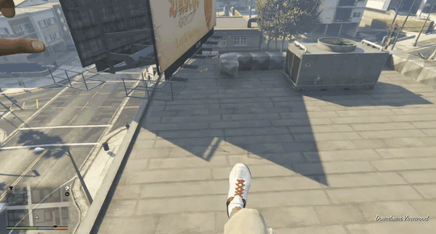

# Freerunning and Skating in V

<p align="center"></p>

**Mirror's Edge parkour and Skate 3 skating in GTA V Legacy story mode.** One launcher, two cards: install either one or both.

> **Beta:** things will break. Please report what you find in [Issues](../../issues), with the logs (see [Logs](#logs)).

## What it is

- **Faith Runner (parkour):** [Tanner](https://github.com/tnrjns/faith-runner)'s Mirror's Edge movement (run, wallrun, wallclimb, vault, ledge grab, pull-up, slide, roll, ladders) on GTA's real buildings, cars and props. Faith's first-person arms and legs (or your GTA character's own) and her sounds come from your own Mirror's Edge: Install copies the 16 files it needs (about 65 MB) into `GTA V\FaithRunnerV\MirrorsEdge`, so Mirror's Edge can be uninstalled afterwards.
- **SK8V (skating):** [becaring](https://github.com/becaring/SK8V)'s Skate 3 controls and physics. It isn't part of this download: the launcher fetches becaring's newest release from his GitHub and runs his own setup, right inside the launcher, with your own Skate 3 disc.

The launcher also checks for updates to both.

## Requirements

- Windows 10 or 11 x64, **GTA V Legacy 1.0.3889.0** (Story Mode, BattlEye off). Not Enhanced, not Online.
- [ScriptHookV](https://www.dev-c.com/gtav/scripthookv/) v3889.0 with its ASI loader (`dinput8.dll`).
- **For parkour:** Mirror's Edge (2008) for PC (Steam, EA app or disc), installed while you install Faith Runner. Keyboard and mouse or a controller.
- **For SK8V:** your own Skate 3 Xbox 360 disc image (ISO or extracted folder), a controller, an internet connection and about 7 GB free on the GTA drive during setup (about 2 GB stays). See [SK8V's requirements](https://github.com/becaring/SK8V#requirements).

## Install

1. Download the zip from [Releases](../../releases) (not "Source code"), unzip it anywhere outside the GTA folder, and close GTA V.
   Install ScriptHookV if you haven't: copy **both** `ScriptHookV.dll` and `dinput8.dll` from its `bin` folder into the GTA V folder.
2. Run `Launcher.exe`. It finds GTA V and Mirror's Edge by itself when it can; **Change** picks another folder.
3. Faith Runner card: **Install**. SK8V card: pick your Skate 3 disc and stance, then **Download & install**.
4. Press **PLAY**.

Keep the launcher: open it again to get updates. Your parkour settings are kept.

**Without the launcher window** (Faith Runner, from a command prompt in the unzipped folder, GTA closed):
A launcher-less download is planned and would just use a script to install faithrunner alone.

```
Launcher.exe --install-parkour --gta "<GTA V folder>" --mirrors "<Mirror's Edge folder>"
```

## Controls (Faith Runner)

| Action | Keyboard and mouse | Controller |
|---|---|---|
| Parkour on / off | F8 | both sticks clicked together |
| Parkour settings menu | hold F8 half a second | hold both sticks |
| Move / look | W A S D / mouse | left stick / right stick |
| Jump, wallrun, climb, grab | Space | A or LB |
| Crouch, slide, roll, let go | Shift, Ctrl or C | B or LT |
| Quick turn (180°) | Q | Y |

SK8V's controls: see [its README](https://github.com/becaring/SK8V#controls).

## Known limits (beta)

**Big things still missing:**

- **Water doesn't end parkour mode.** Jumping or falling into water should hand you back to GTA so you swim; for now, press F8 to switch parkour off first.
- **Pedestrians have no collision.** You run straight through people.
- **Missions are untested.** Nobody knows yet how parkour mode behaves during story missions: switch it off with F8 if one acts up.
- **Some of Faith Runner's moves can't happen in GTA yet**, because the mod only finds ladders in the world so far: swing poles, balance beams (planned for narrow parapets and fence tops), barging or kicking doors open, tripping on barbed wire and soft landings on mattresses.

**Not tried in GTA yet** (they're in Faith Runner and should work, but haven't been tested): dodge, 180 in the air, the wallclimb turn and kick-off, shimmying along and round ledges, coil and the classic springboard. The wall-to-wall push-off works but still needs some polish.

Also:

- Parkour and skating don't run at the same time: put the board away before pressing F8.
- First person only for parkour.
- A fall from about 20 m ends parkour with GTA's ragdoll (`LethalFall` in `FaithRunnerV.ini`).
- Teleporting while either mode is on can drop you through the map: switch it off first.

## Logs

Parkour: `FaithRunnerV.log` in the GTA V folder. SK8V: `%LOCALAPPDATA%\SkateV`.

## Uninstall (GTA closed)

- **Faith Runner:** the **Remove** button on its card. By hand: delete `FaithRunnerV.asi`, `FaithRunnerV.ini` and the `FaithRunnerV` folder from the GTA V folder.
- **SK8V:** see [Uninstall in SK8V's README](https://github.com/becaring/SK8V#uninstall).
- ScriptHookV is left alone either way.

## Building from source

Needs [Rust](https://rustup.rs) and the Visual Studio C++ build tools. From the repository folder:

```
powershell -ExecutionPolicy Bypass -File release\build-release.ps1 -Version 0.1.0-beta
```

It builds `launcher` and `faithrunner-v` and makes the zip in `release\out`.

| Folder | What it is |
|---|---|
| `launcher/` | The launcher (Rust, tao + wry) |
| `faithrunner-v/` | Faith Runner V, the parkour ASI (Rust) |
| `third_party/faith-runner/` | Tanner's movement, animation and Mirror's Edge readers, with the GTA changes |
| `rust/svwc/` | becaring's GTA collision decoder from SK8V, unchanged |
| `media/` | The launcher card video and SK8V's card picture |
| `release/` | The release build script and the texts that go in the zip |

## Credits and licences

- **Faith Runner** by Tanner, MIT: https://github.com/tnrjns/faith-runner
- **SK8V** by becaring, Apache-2.0: https://github.com/becaring/SK8V. This repository is a fork of SK8V; SK8V's own files live in his repository.
- **Live GTA collision reading** by Sol4ra (LS-Skate-LiveCollision), as adapted by SK8V.

This project's own code is MIT ([LICENSE](LICENSE)); [NOTICE](NOTICE) lists exactly which parts come from Faith Runner and SK8V and what was changed. It is an unofficial fan project, not made or endorsed by them, and unaffiliated with EA, DICE, Rockstar Games or Take-Two Interactive. It contains no Mirror's Edge, Skate 3 or GTA V code or data: everything comes from your own copies.

Coded with Claude (Anthropic's AI), through Claude Code.
